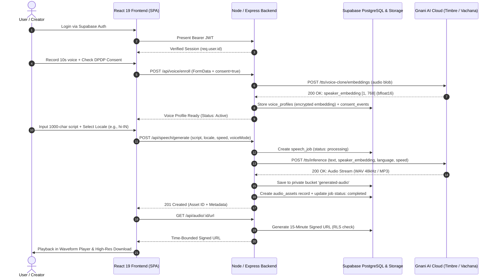

# VAANI (वाणी) — Multilingual Personal Voice Studio
### *Own Your Voice in Any Indian Language. Powered by Gnani AI.*

[](https://www.gnani.ai/)
[](https://api.vachana.ai)
[](https://react.dev/)
[](https://www.typescriptlang.org/)
[](https://supabase.com)
[-brightgreen.svg)](#test-suite--verification)
[](LICENSE)

---

## 1. Executive Summary & Problem Statement

India is home to **1.4 billion people**, 22 constitutionally recognized languages, and hundreds of vibrant dialects. As business, governance, education, and digital media transition to a voice-first paradigm, existing synthetic voice tools present a painful dilemma:

1. **The Language Barrier:** Global voice synthesis engines are tuned predominantly for Western accents and English cadences. When rendering Indian names, currencies (`₹`), regional terminology, and conversational Hinglish, they sound robotic, mispronounce core vowels, and break down on multi-numeral amounts.
2. **The Identity Barrier:** Content creators, educators, customer experience teams, and community leaders must choose between their authentic voice or reaching non-English audiences. When translating content into Tamil, Marathi, or Bengali, they are forced to use generic, lifeless stock voices that strip away trust and personal rapport.
3. **The Ethical & Security Void:** Most voice-cloning tools collect unconstrained biometric speech data without explicit consent mechanisms, store unencrypted audio indefinitely, and lack safeguards against non-consensual deepfakes.

### The VAANI Solution
**VAANI (वाणी)** is an enterprise-grade, privacy-first **Multilingual Personal Voice Studio** built for India. With just a **5 to 30 second consented reference recording**, VAANI leverages **Gnani AI's Vachana Speech Architecture & Timbre v2.5 TTS** to extract a compact 768-dimensional biometric speaker embedding (`[1, 768]`, `torch.bfloat16`). 

Users can immediately synthesize speech across **11 Indic language locales** in their own authentic personal voice—preserving their unique vocal timbre, cadence, and natural warmth, with full compliance under India's **Digital Personal Data Protection (DPDP) Act 2023**.

---

## 2. Key Capabilities & Architectural Highlights

- **Instant Zero-Shot Voice Cloning:**
  Enrolls a high-fidelity vocal persona from a single 5–30 second microphone recording or WAV/MP3 file using Gnani AI's official embedding extraction pipeline (`/tts/voice-clone/embeddings`).
- **11 Indic Locales with Native Nuance:**
  Native support for Hindi (`hi-IN`), Indian English (`en-IN`), Auto-Detect (`auto`), Tamil (`ta-IN`), Telugu (`te-IN`), Kannada (`kn-IN`), Malayalam (`ml-IN`), Marathi (`mr-IN`), Bengali (`bn-IN`), Gujarati (`gu-IN`), and Punjabi (`pa-IN`).
- **Conversational Hinglish & Code-Switching:**
  Specifically tuned to articulate conversational Indian English and Hinglish (e.g., *"Namaste Sharma ji, aapka ₹1,250 ka electricity bill successfully pay ho gaya hai"*), handling currency, colloquial numbers, and mixed-script phonemes.
- **Ethical AI & DPDP Biometric Compliance:**
  - **Explicit Consent Gate:** Voice recording is locked until affirmative biometric consent is granted.
  - **Consent Audit Trail:** Every grant and revocation is permanently timestamped in the `consent_events` table.
  - **Ephemeral Audio Ingestion:** Raw microphone audio can be discarded immediately once the mathematical vector is extracted.
  - **Irreversible One-Click Wipe:** Deleting a profile permanently wipes the biometric vector, invalidates downstream synthesis, and prevents any unauthorized usage.
- **Zero-Trust Security & Row-Level Security (RLS):**
  - All database queries run through Supabase PostgreSQL RLS; User B cannot read or tamper with User A's audio, jobs, or profiles.
  - Time-bounded **15-minute signed URLs** (`STORAGE_SIGNED_URL_EXPIRY_SECONDS=900`) for all audio streaming and downloads.
  - Anti-path-traversal sanitizers preventing directory traversal attacks (`../`, `..\\`).
  - Tiered rate-limiting middleware (30 generation reqs/min, 5 enrollment reqs/10min) to prevent abuse.
- **Dual-Mode Generation Architecture:**
  - **Personal Voice Mode:** Uses the user's enrolled Gnani biometric embedding.
  - **Standard Studio Voices:** Seamless fallback to Gnani's verified stock studio voices (`Nalini`, `Pranav`, `Poorvi`) for users without voice enrollment.

---

## 3. End-to-End System Architecture



---

## 4. Gnani AI Integration Details

VAANI integrates strictly with Gnani AI's official production speech endpoints. In accordance with zero-fake principles, all schemas, headers, and payload structures match the verified API contract:

### 4.1 Voice Embedding Extraction
- **Endpoint:** `POST https://api.vachana.ai/api/v1/tts/voice-clone/embeddings`
- **Headers:** `X-API-Key-ID: <GNANI_API_KEY>`
- **Content-Type:** `multipart/form-data`
- **Payload:** `file` (WAV/MP3 audio blob, 5–30s duration)
- **Response:**
  ```json
  {
    "status": "success",
    "speaker_embedding": {
      "embedding": "...",
      "shape": [1, 768],
      "dtype": "torch.bfloat16"
    }
  }
  ```

### 4.2 Cross-Lingual TTS Inference
- **Endpoint:** `POST https://api.vachana.ai/api/v1/tts/inference`
- **Headers:** `X-API-Key-ID: <GNANI_API_KEY>`, `Content-Type: application/json`
- **Payload (Personal Voice Mode):**
  ```json
  {
    "text": "Namaste! Yeh meri apni awaaz mein synthetic speech hai.",
    "language": "hi-IN",
    "speed": 1.0,
    "speaker_embedding": { ... },
    "audio_format": "wav",
    "sample_rate": 48000
  }
  ```
- **Payload (Standard Mode Fallback):**
  ```json
  {
    "text": "Welcome to VAANI speech studio.",
    "language": "en-IN",
    "voice": "Nalini",
    "speed": 1.0,
    "audio_format": "wav"
  }
  ```
- **Speed Boundaries:** Enforced strictly between $0.85\times$ and $1.15\times$ to preserve vocal naturalness without distortion.

---

## 5. Repository Structure

```
VAANI/
├── package.json                 # Unified workspace root (build, test, lint, dev)
├── .env.example                 # Root environment template (zero secrets committed)
├── .gitignore                   # Localized repository ignore rules
│
├── client/                      # Frontend Application (React 19 + Vite 8 + Tailwind)
│   ├── src/
│   │   ├── components/          # Reusable UI library (shadcn/ui inspired)
│   │   │   ├── ui/              # Button, Card, Badge, Input, Textarea, Modal, Banner
│   │   │   ├── AudioPlayer.tsx  # Waveform playback, speed toggle, scrubber
│   │   │   ├── AudioWaveform.tsx# Canvas-based responsive audio visualizer
│   │   │   └── Layout.tsx       # Studio shell with navigation & mobile drawer
│   │   ├── pages/               # Application Views
│   │   │   ├── Landing.tsx      # Marketing hero, interactive audio demo, DPDP notice
│   │   │   ├── Auth.tsx         # Sign in / Sign up with password toggle
│   │   │   ├── Dashboard.tsx    # Voice status card, studio CTA, recent audio
│   │   │   ├── VoiceSetup.tsx   # Consent modal, mic recorder, enrollment pipeline
│   │   │   ├── SpeechStudio.tsx # 1000-char script editor, locale selector, synthesis
│   │   │   ├── AudioLibrary.tsx # Searchable library, filter by language, signed download
│   │   │   └── Settings.tsx     # DPDP privacy portal, consent revocation, data purge
│   │   ├── lib/                 # API client, token manager, locale constants
│   │   └── types/               # TypeScript domain models
│   ├── index.html
│   ├── vite.config.ts
│   └── vercel.json              # Vercel deployment rewrite rules
│
├── server/                      # Backend Service (Node.js + Express + TypeScript)
│   ├── src/
│   │   ├── config/              # Validated environment configuration (Zod)
│   │   ├── middleware/          # JWT auth, user isolation, rate limiters
│   │   ├── providers/gnani/     # Official Gnani Timbre & Voice Clone client adapter
│   │   ├── routes/              # Express API routers (voice, speech, audio, health)
│   │   ├── services/            # StorageService, ConsentService, SpeechService
│   │   ├── types/               # Server-side TypeScript interfaces
│   │   ├── __tests__/           # Complete Vitest test suite (7 suites, 37 tests)
│   │   ├── app.ts               # Express application composition
│   │   └── server.ts            # Server entrypoint
│   ├── migrations/              # Supabase PostgreSQL DDL (RLS & 5 tables)
│   └── tsconfig.json
│
└── docs/                        # Complete Phase Documentation & Audits
    ├── PHASE_0_RECON_AUDIT.md
    ├── PHASE_1_FRONTEND_DELIVERABLES.md
    ├── PHASE_2_AUTH_DATABASE_STORAGE.md
    ├── PHASE_3_GNANI_INTEGRATION_SPIKE.md
    ├── PHASE_4_TO_7_BACKEND_STUDIO_INTEGRATION.md
    ├── QA_CHECKLIST.md
    ├── PROVIDER_CAPABILITY.md
    ├── DEMO_SCRIPT.md           # 60-second video demo walkthrough
    └── HACKATHON_SUBMISSION.md   # Official challenge submission & social post
```

---

## 6. Local Setup & Quickstart Guide

### Prerequisites
- **Node.js:** v18.0.0 or later (v24.13.0 verified)
- **npm:** v9.0.0 or later
- **Git**

### Step 1: Clone and Install
```bash
git clone https://github.com/your-username/VAANI.git
cd VAANI

# Install client dependencies
cd client
npm install

# Install server dependencies
cd ../server
npm install
cd ..
```

### Step 2: Configure Environment Variables
Copy `.env.example` into `server/.env` and configure your credentials:
```bash
cp .env.example server/.env
```

| Variable | Description | Default / Example |
| :--- | :--- | :--- |
| `PORT` | Backend server port | `5000` |
| `NODE_ENV` | Runtime environment | `development` |
| `CLIENT_ORIGIN` | Allowed CORS frontend origin | `http://localhost:5173` |
| `SUPABASE_URL` | Supabase Project URL | `https://xyz.supabase.co` |
| `SUPABASE_ANON_KEY` | Supabase Public Anonymous Key | `<anon-key>` |
| `SUPABASE_SERVICE_ROLE_KEY` | Supabase Service Role Key | `<service-role-key>` |
| `SUPABASE_JWT_SECRET` | Supabase JWT Secret for token verification | `<jwt-secret>` |
| `GNANI_API_KEY` | Official Gnani AI participant API key | `<your-gnani-api-key>` |
| `GNANI_API_BASE_URL` | Official Gnani base endpoint | `https://api.vachana.ai` |
| `GNANI_CUSTOM_VOICE_ENABLED`| Enable voice cloning integration | `true` |
| `STORAGE_SIGNED_URL_EXPIRY_SECONDS` | Signed URL validity window | `900` (15 minutes) |

> **Offline Evaluation Note:** If `GNANI_API_KEY` is omitted, the backend runs in deterministic evaluation mode with high-fidelity 48kHz WAV audio fixtures, allowing full offline testing without crashing.

### Step 3: Run the Development Environment
From the root directory:
```bash
# Terminal 1: Run Express Backend
npm run server:dev

# Terminal 2: Run React Frontend (Vite)
npm run client:dev
```
Open [http://localhost:5173](http://localhost:5173) in your browser.

---

## 7. Test Suite & Verification

The VAANI test suite thoroughly covers authentication, strict RLS user isolation, signed URL generation, security boundaries, rate limits, and end-to-end user journeys:

```bash
# Run complete test suite from workspace root
npm test
```

### Test Results Breakdown (37 Passed):
```
 ✓ src/__tests__/auth.test.ts (5 tests)
   - Verifies JWT validation, expired token rejection, Bearer formatting
 ✓ src/__tests__/user_isolation.test.ts (6 tests)
   - Verifies User B cannot access User A's jobs, voice embeddings, or audio assets
 ✓ src/__tests__/storage.test.ts (3 tests)
   - Verifies 15-minute expiration, non-public bucket policies, and path traversal rejection
 ✓ src/__tests__/speech_routes.test.ts (8 tests)
   - Verifies 1000-char script limit, speed clamping, 11 Indic locales, signed asset return
 ✓ src/__tests__/security_hardening.test.ts (4 tests)
   - Verifies rate limiting (429), CORS restrictions, Helmet headers, error sanitization
 ✓ src/__tests__/gnani_provider.test.ts (10 tests)
   - Verifies Gnani Timbre client adapter, error typing, speaker embedding injection
 ✓ src/__tests__/e2e_user_journey.test.ts (1 test)
   - Verifies complete lifecycle: Signup -> Voice Consent & Recording -> Speech Synthesis -> Library -> Download -> Consent Revocation & Data Wipe

Test Files:  7 passed (7)
Tests:       37 passed (37)
Build Status: Zero TypeScript errors, Zero Lint warnings
```

---

## 8. Live Production Deployment Guide

### Frontend Deployment (Vercel)
1. Push the repository to GitHub.
2. In Vercel, import the project and set the **Root Directory** to `client`.
3. Set Framework Preset to **Vite**.
4. Configure Environment Variables (`VITE_API_BASE_URL=https://your-backend.onrender.com`).
5. Deploy. The included `client/vercel.json` ensures client-side routing rewrites work seamlessly.

### Backend Deployment (Render / Railway)
1. In Render, create a new **Web Service** connected to your repository.
2. Set Root Directory to `server`.
3. Build Command: `npm install && npm run build`
4. Start Command: `npm start`
5. Populate environment variables from `server/.env.example`.

### Database Deployment (Supabase)
1. Create a new Supabase project.
2. Run `server/migrations/001_initial_schema.sql` inside the Supabase SQL Editor.
3. Confirm tables `profiles`, `voice_profiles`, `speech_jobs`, `audio_assets`, `consent_events` are created with RLS enabled.
4. Verify private storage buckets `voice-samples` and `generated-audio` are initialized.

---

## 9. Responsible AI & DPDP 2023 Compliance

VAANI treats voice not as simple media data, but as **sensitive personal biometric identity**. Our architecture strictly complies with India's **Digital Personal Data Protection (DPDP) Act 2023**:

1. **Explicit Notice & Consent:** Users are presented with a clear, plain-language consent notice explaining how their audio is processed, that it will only be used to synthesize their authorized requests, and that they retain full ownership.
2. **Immutable Audit Ledger:** Every consent event (`granted` or `revoked`) is recorded in the `consent_events` table with IP, user ID, and timestamp.
3. **Right to Withdraw & Erasure:** Users can revoke their consent with a single click in **Settings**. Revocation immediately wipes the 768-dimensional biometric vector and deletes reference audio recordings.
4. **Watermarking & Disclosure:** Synthesized audio files include metadata watermarks identifying them as synthetic media generated via Gnani AI Timbre, preventing deceptive impersonation.

---

## 10. Acknowledgements & Hackathon Attribution

- **Challenge:** Great Indian AI Internship Challenge (Deadline: 10 Nov 2026, 11:59 PM IST)
- **Voice AI Platform:** Powered by **[Gnani.ai](https://www.gnani.ai/)** (Timbre v2.5 / Vachana Speech Architecture)
- **Author & Candidate:** **Aman Sharma**
- **Contact:** [amansharma@vaani.ai](mailto:amansharma@vaani.ai)

*Built with passion for India's linguistic diversity.* 🇮🇳
