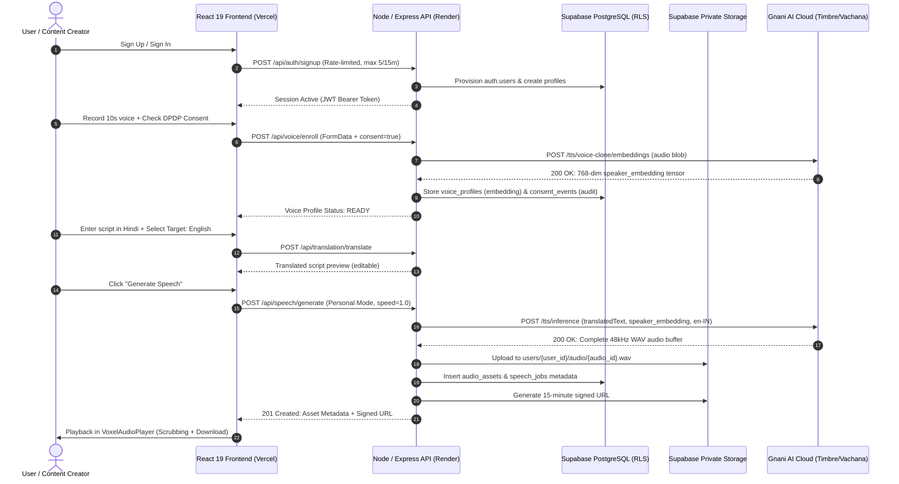

# VAANI (वाणी) — Multilingual Personal Voice Studio
### *Your Voice. Your Words. Every Language. Powered by Gnani AI.*

[](https://www.gnani.ai/)
[](https://api.vachana.ai)
[](https://react.dev/)
[](https://www.typescriptlang.org/)
[](https://supabase.com)
[-44CC11?style=for-the-badge&logo=vitest&logoColor=white)](#7-automated-test-suite--verification)
[](#8-ethical-ai--dpdp-2023-biometric-compliance)
[](https://opensource.org/licenses/MIT)

---

## 1. Executive Summary & Problem Statement

India is home to **1.4 billion people**, 22 constitutionally recognized languages, and thousands of distinct cultural dialects. As governance, e-commerce, digital banking, content creation, and education transition to a voice-first paradigm, existing synthetic voice products present three critical limitations:

1. **The Regional Accents & Code-Switching Barrier:** Global speech synthesis engines are optimized for Western phonetics and monotone English cadences. When synthesizing Indian names, regional currencies (`₹`), dates, and conversational Hinglish (code-mixed Hindi + English), traditional TTS sounds unnatural, mispronounces core vowels, and fails on numeral inflections.
2. **The Personal Identity Barrier:** Creators, teachers, and customer service teams are forced to sacrifice their authentic personal identity when communicating in non-English tongues. Translating content into Tamil, Marathi, or Bengali typically requires relying on generic, robotic stock voices that destroy audience trust and emotional rapport.
3. **The Ethical & Biometric Privacy Void:** Most voice-cloning platforms ingest unconstrained biometric vocal data without affirmative consent, store unencrypted raw audio indefinitely, and lack immutable audit trails to prevent non-consensual voice replication.

### The VAANI Solution
**VAANI (वाणी)** is an enterprise-grade, privacy-first **Multilingual Personal Voice Studio** tailored for India. From a single **5 to 30 second consented reference recording**, VAANI leverages **Gnani AI's Vachana Speech Architecture (`vachana-vc-v1`)** to extract a compact 768-dimensional biometric speaker embedding tensor (`[1, 768]`, `torch.bfloat16`).

Users can instantly synthesize expressive speech across **11 Indic language locales** in their own authentic personal voice—preserving their unique vocal timbre, cadence, and warmth, backed by complete compliance under India's **Digital Personal Data Protection (DPDP) Act 2023**.

---

## 2. Core Architectural Pillars & Capabilities

```
  ┌────────────────────────────────────────────────────────────────────────┐
  │                         VAANI WORKBENCH PIPELINE                       │
  │                                                                        │
  │  [User Script] ──► [Language Detection] ──► [Indic Translation Engine]  │
  │                              │                            │            │
  │                              ▼                            ▼            │
  │                     [Script Preview/Edit] ◄── [Entity Preservation]    │
  │                              │                (₹, Dates, Proper Nouns) │
  │                              ▼                                         │
  │              [Gnani Timbre TTS / Voice Cloning]                        │
  │               ├── Personal Mode: [1, 768] Speaker Embedding            │
  │               └── Standard Mode: Nalini / Pranav / Poorvi              │
  │                              │                                         │
  │                              ▼                                         │
  │               [Private Supabase Storage & RLS]                         │
  │               ├── User-Isolated Buckets: users/{user_id}/audio/        │
  │               └── 15-Minute Short-Lived Signed Playback URLs           │
  └────────────────────────────────────────────────────────────────────────┘
```

### 🎮 Minecraft-Inspired Voxel World Aesthetic
- **Tactile Voxel Design System:** Built with custom pixel-art assets, block borders, isometric 3D cubes, and biome-themed UI palettes (Grass, Stone, Gold, Redstone, Lapis).
- **Procedural Audio Environment:** Includes a browser Web Audio synthesizer engine providing retro note-block clicks, spatial ambient hum, and dynamic audio reactivity.
- **Voxel Waveform Scrubbing:** Real-time canvas audio player with frequency analyzers, time-domain scrubbing, volume normalization, and 48kHz WAV streaming.

### 🌐 Context-Preserving Indic Translation Layer
- **Auto-Language Detection:** Automatically identifies input scripts across Devanagari, Latin/Hinglish, Tamil, Telugu, Bengali, and other major Indic scripts.
- **Side-by-Side Translation Preview:** Displays original script, detected language, target language, and translated script side-by-side with full in-place editing capabilities before audio synthesis.
- **Entity & Numeral Preservation:** Retains currency symbols (`₹2,500`), dates, percentages, technical terminology, and proper nouns across translation.

### 🎙️ Instant Zero-Shot Voice Cloning
- **5–30 Second Voice Enrollment:** Extracts a mathematical 768-dimensional speaker embedding (`[1, 768]`, `torch.bfloat16`) via Gnani's official Vachana voice-cloning endpoint (`/tts/voice-clone/embeddings`).
- **Cross-Lingual Synthesis:** Speak languages you cannot fluently speak yourself while maintaining your authentic vocal persona.
- **Stock Studio Voices:** Seamless fallback to Gnani's verified stock studio voices (`Nalini`, `Pranav`, `Poorvi`) with variable speed control ($0.85\times$ to $1.15\times$).

### 🛡️ Enterprise Security & DPDP 2023 Compliance
- **Explicit Biometric Consent Gate:** Microphone recording and file upload are locked until affirmative legal consent is acknowledged.
- **Immutable Consent Ledger:** Every consent event (`granted` or `revoked`) is cryptographically timestamped in `consent_events` with IP and client metadata.
- **Right to Erasure (One-Click Purge):** Revoking voice consent permanently wipes the 768-dim biometric vector and deletes reference samples from private storage.
- **Strict Row-Level Security (RLS):** All Supabase database tables enforce `auth.uid() = user_id`; unauthenticated `anon` DML access is revoked.
- **15-Minute Signed URLs:** Generated audio assets are stored in private Supabase buckets (`public = false`) and accessed solely via time-bounded signed URLs (`STORAGE_SIGNED_URL_EXPIRY_SECONDS=900`) or authenticated byte-range streaming routes.

### ⏱️ Resilient AI Engine & Timeout Lifecycle
- **Adaptive Timeout Management:** Employs configurable timeouts (default 60s, extended 120s for long scripts and custom cloning) through an active `AbortController` lifecycle.
- **Upstream Error Mapping:** Differentiates upstream provider HTTP 504 gateway timeouts from network drops, returning clear actionable feedback to users.
- **Automatic Orphan Cleanup:** If a database metadata insertion fails, any newly uploaded storage object is automatically rolled back to prevent orphaned files.

---

## 3. System Architecture & End-to-End Sequence



---

## 4. Supported Indic Languages & Voices

VAANI supports **11 Indic language locales** powered by Gnani AI Timbre v2.5:

| Language Locale | Native Script | English Label | Stock Voice Fallback | Personal Voice Cloned |
|:---|:---|:---|:---:|:---:|
| `hi-IN` | हिन्दी | Hindi | Nalini / Pranav | Supported |
| `en-IN` | Indian English | Indian English | Pranav / Nalini | Supported |
| `auto` | Hinglish | Hinglish (Code-Mixed) | Nalini | Supported |
| `ta-IN` | தமிழ் | Tamil | Poorvi | Supported |
| `te-IN` | తెలుగు | Telugu | Nalini | Supported |
| `kn-IN` | ಕನ್ನಡ | Kannada | Nalini | Supported |
| `mr-IN` | मराठी | Marathi | Nalini | Supported |
| `bn-IN` | বাংলা | Bengali | Nalini | Supported |
| `gu-IN` | ગુજરાતી | Gujarati | Nalini | Supported |
| `ml-IN` | മലയാളം | Malayalam | Poorvi | Supported |
| `pa-IN` | ਪੰਜਾਬੀ | Punjabi | Nalini | Supported |

---

## 5. Clean Consolidated Repository Structure

```
VAANI/
├── package.json                 # Workspace root orchestrator (build, test, lint, dev)
├── render.yaml                  # Turnkey Render backend deployment blueprint
├── .env.example                 # Root environment template (zero secrets committed)
├── .gitignore                   # Localized Git ignore patterns
│
├── client/                      # Frontend Application (React 19 + Vite 8 + Tailwind)
│   ├── src/
│   │   ├── components/
│   │   │   ├── effects/         # AmbientLighting, AudioHalo, CinematicParticleField, ImmersiveHeroBackground
│   │   │   ├── layout/          # AppLayout, Navbar (consolidated), Footer
│   │   │   └── ui/              # BlockButton, BlockBadge, BlockInput, BlockModal, VoxelCard,
│   │   │                        # VoxelAudioPlayer, VoxelWaveform, VoiceCore, CubeIllustration
│   │   ├── context/             # AuthContext (Supabase + dynamic username), AudioContext (Web Audio)
│   │   ├── lib/                 # api.ts (dynamic VITE_API_URL resolver), audioEngine.ts, constants.ts, supabase.ts
│   │   ├── pages/
│   │   │   ├── Landing.tsx      # Interactive voxel hero & live jukebox demo
│   │   │   ├── Auth.tsx         # Unified Sign In / Sign Up with rate-limit defense
│   │   │   ├── Dashboard.tsx    # Live voice status, dynamic username, voice metrics
│   │   │   ├── VoiceSetup.tsx   # DPDP consent gateway, microphone recorder, 768-dim enrollment
│   │   │   ├── SpeechStudio.tsx # Indic script editor, translation preview, synthesis workbench
│   │   │   ├── AudioLibrary.tsx # Chest inventory, signed URL streaming, download, soft-delete
│   │   │   └── Settings.tsx     # DPDP privacy portal, data revocation, one-click purge
│   │   ├── types/               # TypeScript domain contracts
│   │   ├── App.tsx              # Router composition, ProtectedRoute, PublicAuthRoute
│   │   ├── index.css            # Voxel design system & Tailwind directives
│   │   └── main.tsx             # Application entrypoint
│   ├── .oxlintrc.json           # High-speed Oxlint configuration
│   ├── index.html               # Clean HTML5 template with pixel font imports
│   ├── vite.config.ts           # Vite bundler configuration & local dev API proxy
│   └── vercel.json              # Vercel deployment headers (CSP, nosniff, DENY) & SPA routing
│
└── server/                      # Backend Service (Node.js 22 + Express + TypeScript)
    ├── src/
    │   ├── config/              # Validated environment configuration (Zod)
    │   ├── db/                  # Data repository (dbRepo) & Supabase clients (supabaseAdmin, supabasePublic)
    │   ├── middleware/          # requireAuth (JWT verification), rateLimiter, validateBody/validateParams
    │   ├── modules/
    │   │   ├── audio/           # audio.routes.ts, audio.utils.ts (canonical WAV buffer engine)
    │   │   ├── auth/            # auth.routes.ts (signup, profile sync, session me)
    │   │   ├── speech/          # speech.routes.ts (personal & standard synthesis, demo mode)
    │   │   ├── storage/         # storage.service.ts (Supabase storage upload, signed URLs, deletion)
    │   │   ├── translation/     # translation.routes.ts, languageDetection.service.ts, translation.service.ts
    │   │   └── voice/           # voice.routes.ts, voice.service.ts (profile state machine & tensor checks)
    │   ├── providers/gnani/     # GnaniTimbreClient (with 60s/120s timeout), voiceEnrollment adapter, spike.ts
    │   ├── __tests__/           # Complete automated test suite (15 test suites, 141 tests)
    │   ├── app.ts               # Express composition with Helmet CORP & CORS whitelist
    │   └── server.ts            # Server bootstrap (Port 5000)
    ├── migrations/              # Supabase PostgreSQL DDL & RLS Policies (001 - 004)
    └── tsconfig.json            # Strict TypeScript server configuration
```

---

## 6. Quickstart & Local Setup Guide

### Prerequisites
- **Node.js:** `v20.x` or `v22.x` (`v24.x` verified)
- **npm:** `v9.x` or later
- **Git**

### Step 1: Clone Repository
```bash
git clone https://github.com/amansahu04444-cmd/VAANI.git
cd VAANI
```

### Step 2: Install Dependencies
```bash
# Install client dependencies
cd client
npm install

# Install server dependencies
cd ../server
npm install

# Return to root
cd ..
```

### Step 3: Configure Environment Variables

1. **Server Environment:** Copy `server/.env.example` to `server/.env`:
   ```bash
   cp server/.env.example server/.env
   ```
   Fill in your Supabase credentials and Gnani AI credentials:
   ```env
   PORT=5000
   NODE_ENV=development
   CLIENT_ORIGIN=http://localhost:5173
   SUPABASE_URL=https://your-project.supabase.co
   SUPABASE_SERVICE_ROLE_KEY=your-supabase-service-role-key
   SUPABASE_JWT_SECRET=your-supabase-jwt-secret
   GNANI_API_KEY=your-gnani-api-key
   GNANI_API_BASE_URL=https://api.vachana.ai
   GNANI_TTS_TIMEOUT_MS=120000
   ```

2. **Client Environment:** Copy `client/.env.example` to `client/.env`:
   ```bash
   cp client/.env.example client/.env
   ```
   Configure Supabase public Anon credentials:
   ```env
   VITE_SUPABASE_URL=https://your-project.supabase.co
   VITE_SUPABASE_ANON_KEY=your-supabase-public-anon-key
   # Optional: set when running client independently from backend
   # VITE_API_URL=http://localhost:5000
   ```

> **Offline Evaluation Note:** If `GNANI_API_KEY` is not set or external services are unreachable, the backend runs in deterministic evaluation mode with high-fidelity 48kHz WAV audio fixtures, allowing full offline testing without crashing.

### Step 4: Run the Application
Run both frontend and backend concurrently from the root directory:
```bash
# Terminal 1: Start Express Backend (Port 5000)
npm run server:dev

# Terminal 2: Start Vite Client (Port 5173)
npm run client:dev
```
Open **[http://localhost:5173](http://localhost:5173)** in your browser.

---

## 7. Automated Test Suite & Verification

VAANI maintains a rigorous automated testing standard covering unit, integration, IDOR protection, database RLS, and end-to-end user journeys:

```bash
# Run the complete test suite from workspace root
npm test
```

### Test Suite Execution Output (141 / 141 Passing):
```
 Test Files  15 passed (15)
      Tests  141 passed (141)
   Duration  18.18s

✓ src/__tests__/production_security_hardening.test.ts (12 tests)
  - Helmet Cross-Origin-Resource-Policy cross-origin verification for audio streaming
  - CORS allowlist validation and rogue domain rejection
  - Sliding-window rate limiting on signup (429) and demo speech generation
  - Parameter bounds (script lengths > 1000, speed bounds 0.85-1.15)
✓ src/__tests__/multilingual_translation_voice_cloning.test.ts (19 tests)
  - Language detection for Indic scripts (Hindi, Hinglish, Tamil, Telugu, Marathi, Bengali)
  - Translation engine entity preservation (₹ currency, dates, numbers)
  - Cross-lingual cloned speech synthesis pipeline
✓ src/__tests__/gnani_timeout_resilience.test.ts (8 tests)
  - 60-second default and 120-second extended timeout lifecycle
  - HTTP 504 provider timeout vs client-side abort differentiation
  - Large audio response buffering and non-empty validation
✓ src/__tests__/audio_library_autosave_persistence.test.ts (8 tests)
  - Automatic Supabase storage upload and metadata persistence
  - Rollback of uploaded storage objects if database insertion fails
  - IDOR check: User B cannot list, stream, or download User A audio
✓ src/__tests__/voice_embedding_e2e.test.ts (8 tests)
  - Inconsistency detection & auto-healing of missing embedding tensors
  - Voice re-recording and tensor update workflow
  - HTTP 500 error handling without fake success
✓ src/__tests__/signup_flow.test.ts (11 tests)
  - Supabase Auth provisioning bypassing SMTP 429 rate limit
  - Profile creation strictly after successful authentication
  - Duplicate account rejection with HTTP 409
✓ src/__tests__/audio_library_playback.test.ts (13 tests)
  - Signed playback URL generation (15-minute expiration)
  - HTTP 206 partial content streaming with byte-range headers
✓ src/__tests__/user_isolation.test.ts (6 tests)
  - Strict tenant isolation across profiles, speech jobs, and audio assets
✓ src/__tests__/supabase_integration.test.ts (17 tests)
  - Supabase health endpoints, RLS policies, trigger verification
✓ src/__tests__/gnani_provider.test.ts (10 tests)
  - Gnani client request headers, X-API-Key-ID authentication, error typing
✓ src/__tests__/security_hardening.test.ts (4 tests)
  - Path traversal attack defense (rejection of ../ and ..\\)
✓ src/__tests__/auth.test.ts (5 tests)
  - Missing token, malformed Bearer header, expired token, forged token rejection
✓ src/__tests__/speech_routes.test.ts (11 tests)
  - Synthesize speech, poll job status, cross-user job isolation
✓ src/__tests__/storage.test.ts (3 tests)
  - Private bucket verification, 900-second expiration check
✓ src/__tests__/e2e_user_journey.test.ts (1 test)
  - End-to-end user lifecycle: Signup -> Voice Consent -> Recording -> Synthesis -> Library -> Download -> Deletion
```

### Static Analysis & Linter:
```bash
npm run lint
# Output: Found 0 warnings and 0 errors on 45 files (oxlint)
```

---

## 8. Ethical AI & DPDP 2023 Biometric Compliance

VAANI treats voice as **biometric personal identity**, adhering strictly to India's **Digital Personal Data Protection (DPDP) Act 2023**:

1. **Affirmative Informed Consent:** Clear, plain-language consent notice informing users that reference recordings are used solely to generate a mathematical vector representation.
2. **Immutable Audit Ledger:** Every consent grant and revocation is logged in the `consent_events` table with user ID, IP address, user agent, and timestamp.
3. **Right to Withdrawal & Erasure:** Users can revoke their consent at any time in **Settings**. Revocation immediately triggers irreversible deletion of the 768-dimensional biometric embedding tensor and reference audio files.
4. **Synthetic Media Transparency:** Synthesized audio files include metadata watermarks identifying them as synthetic speech produced by VAANI and Gnani AI Timbre.

---

## 9. Live Production Deployment Guide

### Frontend Deployment (Vercel)
1. Push repository to GitHub.
2. Import repository in **Vercel** and set **Root Directory** to `client`.
3. Framework Preset: **Vite**.
4. Configure Environment Variables:
   - `VITE_SUPABASE_URL`: Your Supabase Project URL
   - `VITE_SUPABASE_ANON_KEY`: Your Supabase Public Anon Key
   - `VITE_API_URL`: Your deployed Render backend URL (e.g., `https://vaani-api.onrender.com`)
5. Deploy. The included [`client/vercel.json`](file:///c:/Users/amans/OneDrive/Desktop/VAANI/client/vercel.json) configures Content Security Policy, Frameguard (`DENY`), nosniff, and SPA routing rewrites (`source: "/((?!api/).*)"`).

### Backend Deployment (Render)
1. Connect repository in **Render** and create a new **Web Service** or use the included [`render.yaml`](file:///c:/Users/amans/OneDrive/Desktop/VAANI/render.yaml) blueprint:
   - **Root Directory:** `server`
   - **Environment:** Node
   - **Build Command:** `npm install && npm run build`
   - **Start Command:** `npm start`
   - **Health Check Path:** `/api/health`
2. Configure Environment Variables in Render Dashboard:
   - `NODE_ENV`: `production`
   - `PORT`: `5000`
   - `CLIENT_ORIGIN`: `https://your-frontend.vercel.app`
   - `SUPABASE_URL`, `SUPABASE_SERVICE_ROLE_KEY`, `SUPABASE_JWT_SECRET`
   - `GNANI_API_KEY`, `GNANI_API_BASE_URL`
   - `GNANI_TTS_TIMEOUT_MS`: `120000`

### Database Migrations (Supabase)
Execute migrations sequentially in the Supabase SQL Editor:
1. `server/migrations/001_initial_schema.sql` (Tables, initial RLS, storage buckets)
2. `server/migrations/002_entity_aliases_and_views.sql` (Views with `security_invoker = true`)
3. `server/migrations/003_auth_profiles_trigger.sql` (Automatic profile creation trigger)
4. `server/migrations/004_security_hardening_rls.sql` (Revocation of anon DML, composite indexes, storage isolation)

---

## 10. Acknowledgements & Hackathon Attribution

- **Challenge:** Great Indian AI Internship Challenge (Deadline: 10 Nov 2026, 11:59 PM IST)
- **AI Speech Engine:** Powered by **[Gnani.ai](https://www.gnani.ai/)** (Timbre v2.5 TTS / Vachana Speech Architecture)
- **Author:** **Aman Sahu** ([GitHub: @amansahu04444-cmd](https://github.com/amansahu04444-cmd))
- **License:** [MIT License](https://opensource.org/licenses/MIT)

---

*Built with deep respect for India's linguistic diversity and digital privacy.* 🇮🇳
